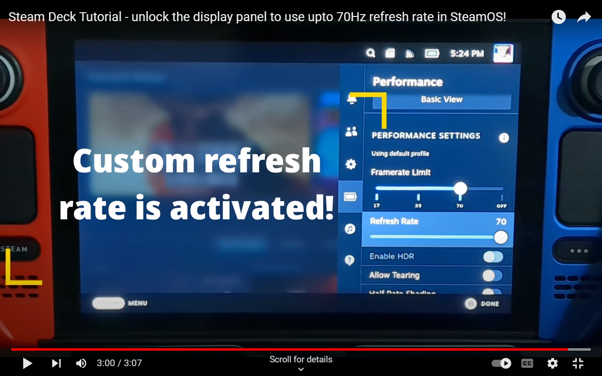

# SteamDeck Refresh Rate Unlocker
This repository contains the instructions and scripts on how to unlock the Steam Deck under SteamOS to use upto 70Hz refresh rate for the display (do not confuse this with FPS). \
Discord user dan2wik for the idea on overclocking the display panel to 70Hz!

> **NOTE**\
> If you are going to use this script for a video tutorial, PLEASE reference on your video where you got the script! This will make the support process easier!
> And don't forget to give a shoutout to [@10MinuteSteamDeckGamer](https://www.youtube.com/@10MinuteSteamDeckGamer/) / ryanrudolf from the Philippines!
>

<b> If you like my work please show support by subscribing to my [YouTube channel @10MinuteSteamDeckGamer.](https://www.youtube.com/@10MinuteSteamDeckGamer/) </b>  
<b> I'm just passionate about Linux, Windows, how stuff works, and playing retro and modern video games on my Steam Deck! </b>

<b>Monetary donations are also encouraged if you find this project helpful. Your donation inspires me to continue research on the Steam Deck! Clover script, 70Hz mod, SteamOS microSD, Secure Boot, etc.</b>

<b>Scan the QR code or click the image below to visit my donation page.</b>

## Disclaimer
1. Do this at your own risk!
2. This is for educational and research purposes only!

## Video Tutorial
**[If you prefer a video tutorial then click here.](https://youtu.be/6loG-BXmeQA)**

## Screenshot - Warning / Disclaimer

## How to Uninstall
Delete the file `~/.config/gamescope/scripts/valve.steamdeck.lcd.70Hz.lua`

## What's New (as of November 2026)
1. Works on SteamOS 3.9 and newer - there is no upper version limit anymore. The mod is installed whenever SteamOS ships the stock gamescope Steam Deck LCD profile.
2. New one-click installer: download `RefreshRateUnlocker.desktop` and double-click it in Desktop Mode. It downloads / updates this repo and starts the script. No terminal needed.
3. On SteamOS 3.7+ the mod is now a small gamescope script that only changes the refresh rate list of the stock profile, so Valve's future fixes to the rest of the profile keep working.
4. No sudo password needed on SteamOS 3.7+. On 3.5 / 3.6.20, if no sudo password is set, a temporary one is set and removed again automatically (same approach as the Decky Loader installer).
5. Desktop Mode detection works under Wayland (default since SteamOS 3.8), returns to Game Mode with `steamos-session-select`, and every step is checked - the script never reports success if something failed.
6. Automated tests (GitHub Actions) on every change and weekly against the latest upstream gamescope profile.

## What's New (as of September 16 2025)
1. Script has been rewritten to work with SteamOS 3.7.x and above only.

## What's New (as of November 16 2024)
1. SteamOS 3.6.20 support

## What's New (as of June 20 2023)
1. Added 20,60 and 20,70.
2. Rewrote the systemd service to adhere to best security practices.
3. Created a simple GUI Toolbox to easily check status, change options or to completely uninstall and revert any changes made.

## Old Changelog
**March 23 2023**
1. rewrite script to use systemd service
2. additional logic for the uninstall
3. optional - check if systemd service is running via game mode

**March 21 2023**
1. added 3 options to choose from - 30,60Hz 30,70Hz and 40,70Hz

**March 16 2023**
1. initial release

## What does this script do?!?
SteamOS 3.7 and newer:
1. Checks that it runs in Desktop Mode on a Steam Deck LCD and that SteamOS ships the stock gamescope Steam Deck LCD profile (`/usr/share/gamescope/scripts/00-gamescope/displays/valve.steamdeck.lcd.lua`).
2. Writes a small gamescope script `~/.config/gamescope/scripts/valve.steamdeck.lcd.70Hz.lua` that changes the allowed refresh rates of that stock profile from 40-60Hz to 40-70Hz. Gamescope runs user scripts after its own profiles, so everything else (colorimetry, mode timings, panel detection) stays as shipped with SteamOS.
3. Nothing in the read-only system partition is changed, and the mod survives SteamOS updates.

SteamOS 3.6.20 - replaces `/usr/bin/gamescope` with a patched binary (md5 checked). SteamOS 3.5 - changes `STEAM_DISPLAY_REFRESH_LIMITS` in `/bin/gamescope-session`.

## Prerequisites for SteamOS
1. SteamOS 3.7 and newer: nothing - no sudo password is needed.
2. SteamOS 3.5 / 3.6.20: if a sudo password is set, the script asks for it. If no password is set, the script sets a temporary one and removes it again when it finishes.

## Installation Steps
**Option 1 - one click, no terminal (recommended)**
1. Go into Desktop Mode.
2. Download [RefreshRateUnlocker.desktop](https://raw.githubusercontent.com/ryanrudolfoba/SteamDeck-RefreshRateUnlocker/main/RefreshRateUnlocker.desktop) (right-click the link → *Save Link As…*) and save it to the Desktop. Make sure the file name ends with `.desktop`.
3. Double-click **Refresh Rate Unlocker (70Hz)** on the Desktop. If KDE asks whether to run the file, allow it.
4. A Konsole window opens, downloads (or updates) this repo into `~/SteamDeck-RefreshRateUnlocker` and starts the script. Continue with step 5 below.

Keep the shortcut - double-click it again any time to update, re-install or uninstall. If `~/SteamDeck-RefreshRateUnlocker` already exists and is a clone of this repo, it is updated; anything else in that folder is kept and renamed to `~/SteamDeck-RefreshRateUnlocker.backup-<date>`.

**Option 2 - terminal**
1. Go into Desktop Mode and open a konsole terminal.
2. Clone the github repo (or `cd ~/SteamDeck-RefreshRateUnlocker && git pull` if you already have it). \
   cd ~/ \
   git clone https://github.com/ryanrudolfoba/SteamDeck-RefreshRateUnlocker.git
3. Execute the script! \
   cd ~/SteamDeck-RefreshRateUnlocker \
   ./install-RefreshRateUnlocker.sh

**Then (both options)**

5. The script will perform several sanity checks and afterwards display a WARNING / DISCLAIMER -\

6. Make sure you understand the WARNING / DISCLAIMER and press YES to proceed. From here on you can choose to INSTALL or UNINSTALL -\

7. Once the install is done, the Steam Deck returns to Game Mode automatically. Open the Quick Access menu → Performance - the refresh rate now goes up to 70Hz.

## How to Uninstall
1. Go into Desktop Mode and run the script again (or double-click the **Refresh Rate Unlocker (70Hz)** shortcut). Select UNINSTALL -\

2. Once the uninstall is done, the stock 40-60Hz range is back. On SteamOS 3.7+ the Steam Deck returns to Game Mode automatically; on 3.5 / 3.6.20 reboot the Steam Deck.
         
## Known Issues
1. When taking a screenshot in-game, the screen will momentarily go blank as it toggles to 60Hz, and then goes back to the custom refresh rate once the screenshot is done.

